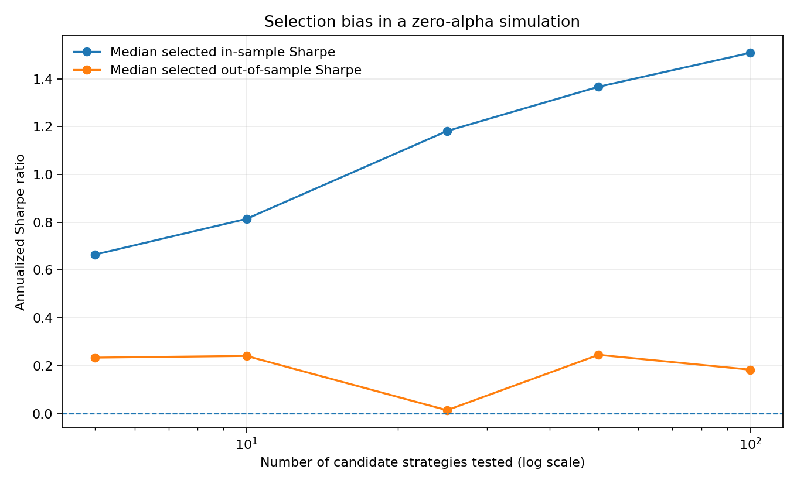

# Quant Strategy Audit

I built this project to explore a problem that comes up in quantitative research: **a strategy can look impressive simply because many variations were tested and the best one was selected**. The toolkit checks return series for a few common sources of false confidence and runs a reproducible simulation to show how selection bias can happen.

This is a research tool, not a trading strategy. The demo uses synthetic returns with zero expected alpha, so its results are not evidence of an edge in real markets.

## What it does

- Calculates annualized Sharpe, volatility, total return, and maximum drawdown.
- Tests average returns with a Newey–West heteroskedasticity/autocorrelation-consistent (HAC) standard error.
- Adjusts p-values using Holm family-wise error control and Benjamini–Hochberg false-discovery-rate control.
- Estimates the Probabilistic Sharpe Ratio (PSR) relative to a chosen benchmark.
- Builds circular moving-block bootstrap intervals for Sharpe to preserve short runs of dependence better than an independent resample.
- Estimates Probability of Backtest Overfitting (PBO) with combinatorially symmetric cross-validation (CSCV).
- Simulates testing more and more zero-alpha candidates, then compares the selected candidate's in-sample and later out-of-sample Sharpe.
- Writes CSV results, a Markdown report, and a plot that can be reviewed or reproduced.

## The main research question

> If I test many candidate strategies and report only the winner, how much of its apparent performance could be due to selection rather than a repeatable effect?

The synthetic experiment gives all candidates zero expected alpha. It selects the candidate with the highest Sharpe in the training segment, then measures that same candidate over a later test segment that was not used for selection. As the number of candidates rises, the selected in-sample result tends to look better even though no candidate was given a true edge.

A sample run is saved in [`reports/demo_run.md`](reports/demo_run.md), with a chart generated from synthetic returns. The numbers are illustrative only; they are not results from live-market data.



## Methods in plain language

### Sharpe and drawdown

The annualized Sharpe ratio scales average excess return by return volatility:

\[
SR_{ann}=\frac{\bar r-r_f}{s_r}\sqrt{A}
\]

Here, \(\bar r\) is the average periodic return, \(r_f\) is the per-period risk-free rate, \(s_r\) is the sample standard deviation, and \(A\) is periods per year (252 for daily returns by default). The maximum drawdown is the largest percentage decline from a previous equity peak.

### Newey–West mean-return test

Daily returns can be volatile and serially related. The Newey–West estimate adjusts the standard error of the mean for heteroskedasticity and autocorrelation up to a selected lag. The p-value here uses a t reference distribution as a practical approximation; it is not a guarantee of significance.

### Multiple-testing corrections

Trying many candidates increases the chance that at least one looks good by luck. Holm adjustment controls family-wise error. Benjamini–Hochberg reports adjusted q-values for false-discovery-rate control under its usual assumptions. These corrections help, but they do not fix poor data, leakage, or a badly designed experiment.

### Probabilistic Sharpe Ratio (PSR)

PSR estimates the probability that the true Sharpe exceeds a benchmark while accounting for sample length, skewness, and kurtosis. The code reports PSR against a zero-Sharpe benchmark. PSR by itself does not correct for searching across many strategies.

### Block bootstrap

Instead of sampling each return independently, the bootstrap resamples circular blocks of consecutive returns. This retains some short-range dependence. The resulting interval is still conditional on the supplied series and is **not selection-adjusted**.

### Probability of Backtest Overfitting (PBO)

The CSCV implementation divides the time series into an even number of contiguous blocks. For each combination of in-sample blocks, it selects the candidate with the highest in-sample Sharpe and ranks that candidate against all other candidates on the complementary blocks. PBO is the fraction of partitions where the selected candidate ranks at or below the out-of-sample median.

PBO depends on the candidates supplied, sample size, and partition design. It is a diagnostic—not a literal probability that a live strategy will fail.

## Quick start

Python 3.10 or newer is recommended.

### 1. Create an environment and install dependencies

Windows Git Bash:

```bash
python -m venv .venv
source .venv/Scripts/activate
python -m pip install --upgrade pip
pip install -r requirements.txt
pip install -e .
```

If Git Bash cannot find `python`, try `py` in the first command and confirm Python is installed.

### 2. Run the demo

```bash
quant-audit demo
```

The command creates an `outputs/demo/` folder containing:

- `synthetic_returns.csv` — generated example return series
- `strategy_audit.csv` — per-candidate metrics and inference diagnostics
- `pbo_partitions.csv` — details for each CSCV partition
- `selection_bias.csv` — selection-bias experiment summary
- `selection_bias.png` — in-sample versus out-of-sample plot
- `audit_report.md` — concise interpretation and limitations

The default demo is deterministic because it uses a fixed random seed. Pass `--seed` to generate a different reproducible run.

### 3. Run the audit on your own returns

Create a CSV with one column per candidate strategy. Use **simple returns in decimal form**: `0.01` means +1%, and `-0.02` means -2%. An optional date column is allowed but is not used in the calculations. Every strategy column must refer to the same ordered observation dates.

Example:

```bash
quant-audit audit --input examples/sample_returns.csv
```

By default, results are written to `outputs/audit/`. You can choose another output folder with `--output-dir`.

**Do not upload private, licensed, or sensitive datasets** to a public repository. The included example data are synthetic.

## Run tests

```bash
python -m pytest
```

The tests cover compounding and drawdown behavior, p-value adjustments, inference helpers, simulator reproducibility, and the PBO partition workflow.

## Reading the outputs

- `strategy_audit.csv`: compare candidate metrics, raw p-values, adjusted p-values, PSR, and bootstrap intervals.
- `pbo_partitions.csv`: inspect which strategy was selected in each in-sample partition and how it ranked out of sample.
- `selection_bias.png`: see whether the best in-sample Sharpe increases as more candidates are tested, while the later out-of-sample result does not improve in the same way.
- `audit_report.md`: short summary of the run and how to interpret it.

A low raw p-value or high Sharpe should not be treated as proof of an edge. Look at adjusted results, PBO, sample size, data quality, economic rationale, realistic costs, and a final chronological holdout together.

## Limitations and next steps

- The built-in demonstration is synthetic, not market data.
- Return-frequency, risk-free-rate, transaction-cost, and execution assumptions matter. This toolkit expects the user to supply returns and does not infer transaction costs.
- The HAC p-value is an approximation; correction methods rely on assumptions about the tested hypotheses.
- PSR, bootstrap confidence intervals, and PBO answer different questions and should not be treated as interchangeable.
- The bootstrap intervals are marginal, not selection-adjusted.
- For real research, freeze a final chronological test set before model selection, account for commissions and slippage, document all trials, and compare against a simple benchmark.

## Project structure

```text
quant-strategy-audit/
├── README.md
├── requirements.txt
├── pyproject.toml
├── src/quant_audit/
│   ├── metrics.py       # Sharpe, volatility, drawdown, compounding
│   ├── inference.py     # HAC test, adjusted p-values, PSR, block bootstrap
│   ├── pbo.py           # CSCV / PBO calculation
│   ├── simulation.py    # Synthetic zero-alpha experiments
│   ├── analysis.py      # Combines audit components
│   ├── report.py        # Markdown report and plot
│   └── cli.py           # Command-line entry points
├── tests/               # Unit tests
├── examples/            # Synthetic CSV example
└── reports/             # Reproducible example output
```

## Disclaimer

For education and research only. This repository is not investment advice and does not establish that any strategy is profitable.

## Validation

- **Automated tests:** 12 passed.
- **Demonstration:** Synthetic data used to illustrate the audit workflow.
- **Statistical methods:** Backtest-overfitting analysis, multiple-testing corrections, and uncertainty estimation.

**Important:** Synthetic demonstration results are illustrative and do not establish profitability or prove an edge in live markets.